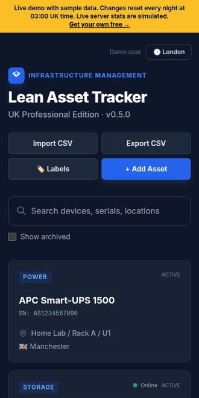

<div align="center">

# Lean Asset Tracker

**Every device you own. One scan away.**

A lightweight, self-hosted asset tracker for homelabs, tech labs and small IT teams.
Stick a QR label on your kit, scan it with your phone, and see where it lives, what changed, and whether it's still alive.

[**Try the live demo**](https://demo.hallveckdigital.co.uk) · [Website](https://hallveckdigital.co.uk) · [Download](https://hallveckdigital.co.uk/self-host) · [Free tools](https://hallveckdigital.co.uk/tools)



</div>

---

## Why another asset tracker?

Snipe-IT and NetBox are excellent, and built for organisations with an IT department. If you look after one rack, one lab or a cupboard full of laptops, they're a lot to set up for "where is that switch and when did we last touch it?". Spreadsheets, meanwhile, don't scan, don't know if a server is up, and don't remember who changed what.

Lean Asset Tracker sits in between: install in a few minutes, use it one-handed in a server room.

## Features

- 🏷️ **Scan-to-open QR labels.** Print onto standard Avery A4 sticker sheets (L7160, 21 per sheet; L7651, 65 per sheet). Any phone camera opens the device. No app.
- 💓 **Live server status.** A single-file, read-only Python agent (stdlib only, sandboxed systemd service) reports CPU, memory, disk, load and uptime every 30 seconds. Online and offline at a glance.
- 🧾 **Full history.** Every create, edit, move, archive and restore is logged with a field-by-field diff.
- 🕑 **Maintenance windows in the server's own timezone.** Times that don't exist when the clocks go forward are refused, windows crossing midnight are handled, and clashes are caught. You see your own time alongside.
- 🌍 **Real-world locations.** Nested locations (Site / Room / Rack / U), plus country, region, city and datacentre. Pick a country and the timezone fills itself in.
- 📥 **Messy CSV in, clean CSV out.** Import understands headers like `Hardware`, `Device`, `Item`, `SN` and `Where`. Exports re-import cleanly. Formula-injection safe.
- 🗄️ **Archive, restore, delete.** Retired kit keeps its history. Permanent delete needs the name typed.
- 👥 **Your team, not just you.** Invite colleagues with a single-use link (no mail server needed), set them as admin or member, deactivate someone the moment they leave. Change your own email and password; a password change signs out every other device. The last admin can never be demoted, deactivated or deleted, so an instance can't be locked out of itself.
- 📱 **Mobile first.** Built and tested on a phone first, then tablet, laptop and desktop.
- 🔒 **Private by default.** Login required, scrypt-hashed passwords, rate-limited sign-in, agent and invite tokens stored hashed, no telemetry.

## Quick start (self-hosted)

You need Linux (or a Pi 4/5 64-bit, or a NAS) with Docker and Compose v2, about 600 MB of disk and 300 MB of RAM.

```bash
# always fetches the current release (-OJ keeps the real versioned filename)
curl -fsSL -OJ https://hallveckdigital.co.uk/download/latest
curl -fsSL -OJ https://hallveckdigital.co.uk/download/latest.sha256
sha256sum -c lean-asset-tracker-*.tar.gz.sha256   # verify before you run it

tar xzf lean-asset-tracker-*.tar.gz
cd lean-asset-tracker
./latctl install
```

The installer prints a **one-time setup link**. Open it to create your admin account. Then:

| Command | What it does |
|---|---|
| `./latctl status` / `logs` | What's running / follow the logs |
| `./latctl backup` | Plain SQL dump to `backups/` |
| `./latctl restore <file>` | Restore (takes a safety backup first) |
| `./latctl update` | Back up, then upgrade |
| `./latctl uninstall [--purge]` | Stop (and optionally delete data) |

> Plain HTTP by default. Keep it on your LAN or a VPN such as Tailscale, and put HTTPS in front before exposing it to the internet.

Prefer not to run it yourself? [Hosted plans](https://hallveckdigital.co.uk/#pricing) are coming, and you can join the early-access list.

## Development

```bash
cp .env.example .env            # set POSTGRES_PASSWORD
docker compose up -d --build    # app on http://127.0.0.1:8001
docker compose exec api python -m pytest -q   # or run tests in a throwaway container, see CI
```

Stack: FastAPI · SQLAlchemy · PostgreSQL · HTMX · Tailwind · Docker Compose. Templates live in `app/templates`, and pure logic (timezones, scheduling, labels, CSV) is kept in small, unit-tested modules.

Run a local copy of the public demo (no login, sample data, simulated agents):

```bash
cd demo && cp .env.example .env && docker compose up -d --build   # http://127.0.0.1:8002
```

## Roadmap

- [ ] Agent auto-fills device specs (CPU model, RAM, disks, OS)
- [ ] Alerts: server offline, disk filling, warranty expiring (email, Discord, ntfy)
- [ ] `latctl update` with automatic rollback
- [ ] Recurring maintenance and an iCal feed
- [ ] Components and rack positions inside servers
- [x] Multi-user accounts, roles and invites
- [ ] Per-location permissions; MSP workspaces

Ideas and bug reports are welcome. Please open an issue.

## Licence

[AGPL-3.0-or-later](LICENSE). Free to use, modify and self-host. If you offer a modified version to others over a network, you must share your changes.

Made in the UK by [Hallveck Digital](https://hallveckdigital.co.uk).
